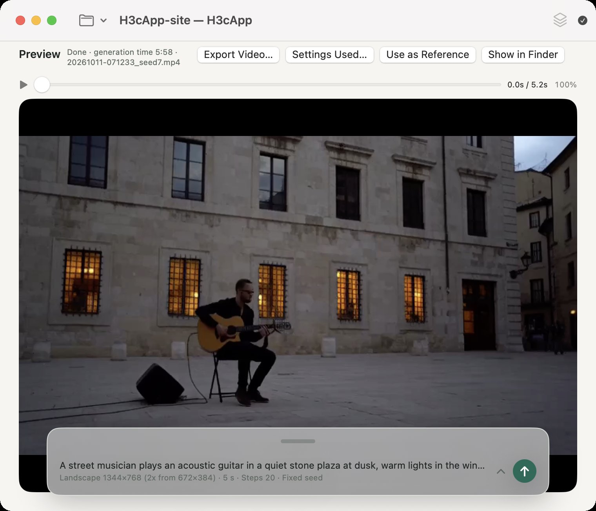

# H3cApp

[English](README.md) | [日本語](README.ja.md)

**Create AI videos with sound, and still images, directly on your Mac.** H3cApp uses [MiniMax H3](https://huggingface.co/MiniMaxAI/MiniMax-H3) and its image models to draw pictures from text and to turn text, images and other media into short videos (still images from v0.10.0). After downloading a model, generation takes place on your Mac—no cloud generation service, Python, or complicated setup required.

**Powered by MiniMax H3** — an independent app, not an official MiniMax product.

## What you can do

- **Text to video:** Describe a scene and generate video with synchronized sound.
- **Image to video:** Choose a starting image, an ending image, or both.
- **Still images:** Draw a picture from text, and change a picture of your own or a generated one with an instruction such as “replace the cup with a small bird.” Pictures go up to about 8 megapixels and can be enlarged, and one you like can become the first frame of a video.
- **Reference-based video:** Guide the result using images, videos or audio (optional Ref2VA model required), or RefMods: references encoded once and saved as small files, compatible with ComfyUI-MiniMaxH3Mod.
- **Lip sync:** Create video matching a voice recording or song.
- **Longer videos:** Continue previous clips and join them automatically.
- **Other features:** Progress previews, project management (new windows open on an untitled project you can name later; videos move between projects), and compatible LoRAs.

## Mac requirements

| Item | Requirement |
|---|---|
| Mac | MacBook Air, MacBook Pro, Mac mini, iMac, Mac Studio, or Mac Pro **with Apple Silicon** |
| Chip | Apple M-series (M1 or later); **M5 recommended** for faster processing |
| Memory | **24 GB or more recommended** |
| macOS | macOS 15 (Sequoia) or later |
| Other software | None for the prebuilt app |

**Memory compatibility:** Tested on an M5 Mac with 24 GB of unified memory. **16 GB has not been tested** and is not guaranteed to work. Macs with **less than 16 GB have not been tested either**. Intel Macs are not supported.

M1–M4 Macs can also use the resident or SSD-streaming compute modes, but processing speed varies by hardware and settings.

## Models and disk space

You download a MiniMax H3 model separately from the app.

| Model configuration | Approximate model storage | Best for |
|---|---:|---|
| **GGUF standard (recommended)** | **45 GB** | Balanced quality and storage |
| GGUF compact | 35 GB | Lower disk usage |
| Official BF16 (FL2VA) | 145 GB | Original unquantized model |
| Official BF16 (FL2VA + Ref2VA) | 290 GB | Original model with reference-based generation |

These figures are **model storage sizes, not RAM requirements**. The GGUF configurations support text-to-video and first/last-image generation. Reference images, videos or audio require an additional **Ref2VA model (about 11–21 GB)**.

Still images use an **image model**, installed separately from the video model.

| Image model | Approximate model storage | Notes |
|---|---:|---|
| MiniMax H3 Image | 22 GB | Uses a video model's text encoder, so install a video model first |
| P-H3-Image (Pruna AI) | 29 GB | No video model needed; at its best at about 8 megapixels |
| P-H3-Image (using the video model) | 10 GB | Uses the DiT of an installed video model; images take about twice as long |

On supported M5 Macs, an optional speed-up cache uses about **19 GB of extra disk space per model**; using Ref2VA as well adds another cache of about 19 GB for it. Leave additional space for downloads, temporary files and generated videos. Models can be stored on an external SSD (for an image model, choose the place under “Location” in its download sheet; from v0.10.1).

See [GGUF model details](docs/GGUF.md) for the available model combinations. [HyperFlow H3 Flash](docs/GGUF.md#hyperflow-h3-flash), a 4/6/8-step derivative of MiniMax H3, can also be imported (its DiT is about 9 GB at Q4_K_M). A DiT in ComfyUI's int8 quantization (with or without ConvRot) [can be imported too](docs/GGUF.md#comfyui-int8-convrot-dits).

## Install and create your first video

1. Download the latest **H3cApp .dmg** from [Releases](https://github.com/JunzoKamahara/H3cApp/releases/latest).
2. Open the .dmg and drag **H3cApp** into **Applications**.
3. Open H3cApp. The setup wizard will help you download a model. **GGUF standard** is a good starting point.
4. Type a prompt, for example, “A quiet beach at sunset, gentle waves and warm light.” Choose the length and size, then click **Generate**.
5. Preview the result and use **Export Video…** to save it.

For still images, choose **Image** with the switch at the top left of the panel and download an image model from the model menu.

Generation can take several minutes or longer depending on the Mac and settings. No Xcode or command-line setup is needed for the downloadable app.

For screenshots and step-by-step instructions, visit the [Getting Started guide](https://junzokamahara.github.io/H3cApp/en/getting-started.html) and [Making and editing still images](https://junzokamahara.github.io/H3cApp/en/image.html).

## Guides and developer documentation

- [User guide: projects, still images, continuing and joining videos](docs/GUIDE.md)
- [Making and editing still images](https://junzokamahara.github.io/H3cApp/en/image.html) · [Comparing still images (models and ways to enlarge)](https://junzokamahara.github.io/H3cApp/en/image-compare.html)
- [Model downloads and GGUF imports](docs/GGUF.md)
- [Making and using RefMods (saved references)](docs/REFMOD.md)
- [User guide and advanced settings](https://junzokamahara.github.io/H3cApp/en/guide.html)
- [Technical reference](docs/TECHNICAL.md) · [Local API](docs/API.md) · [Building from source](docs/BUILD.md)
- [FAQ](https://junzokamahara.github.io/H3cApp/en/faq.html) · [Report an issue](https://github.com/JunzoKamahara/H3cApp/issues)

## Publishing videos and images, and licenses

When publishing a generated video or image, **clearly disclose that it was AI-generated**, as required by MiniMax H3's usage policy. **Export Video…** can add “AI-generated with MiniMax H3” to the video (on by default). You can also use the platform's AI label or mention it in the description. The app includes AI-generation information in the metadata of video files and images (PNG).

H3cApp is under the [MIT License](LICENSE), based on [antirez/h3.c](https://github.com/antirez/h3.c). **The model has separate license terms**; review the [MiniMax H3 Community License](https://huggingface.co/MiniMaxAI/MiniMax-H3/blob/main/LICENSE) before use. Of the image models, MiniMax H3 Image comes under the [MiniMax-H3-Image Community License Agreement](https://huggingface.co/MiniMaxAI/MiniMax-H3-Image/blob/5f90473023975e6271b0ed1dd84c4e88e4bbc6d3/LICENSE), a separate agreement from the video model's (in the EU, the UK, South Korea and the US neither the model nor the pictures made with it may be used); P-H3-Image comes under the same license as the video model. See [third-party notices](THIRD_PARTY_NOTICES.md) and [technical metadata/license notes](docs/TECHNICAL.md#license).
